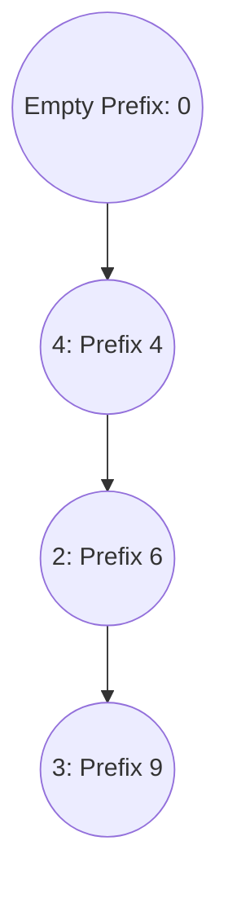

# [437] Path Sum III
**Pattern:** [DFS](../../patterns/dfs.md)
**Complexity:** Time O(V) expected, Space O(V)
**Link:** https://leetcode.com/problems/path-sum-iii/

## Trigger Signals

- Binary Tree 中的 Path 可以從任意節點開始、任意節點結束，但只能沿父節點往子節點的方向走。
- 題目要求的是 Sum 等於 `targetSum` 的**路徑數量**，不是 Maximum Path Sum，也不是只判斷有沒有路徑。
- 節點值可能為負數，因此不能在 `curSum > targetSum` 時提前剪枝，也不能丟掉負數分支。

## Core Insight

最直覺的 Brute Force 是從每個節點啟動一次 DFS，列舉所有合法的 `(start, end)` 組合。這個方向正確，但重複掃描同一子樹，最壞會花 O(V²)。

要將時間改善為平均 O(V)，**不要保存並更新每一種可能的 Downward Path Sum**；改存目前 Root-to-Current 路徑上，各種 **Past Prefix Sum 的出現次數**。

\[
PathSum=CurrentPrefix-AnyPastPrefix
\]

所以當前節點作為終點時，所需的前綴值為：

\[
AnyPastPrefix=CurrentPrefix-targetSum
\]

因此 `prefix_mp[prefix - target]`（值為 Frequency）就是**以目前節點為終點**，且總和為 `target` 的合法 Downward Paths 數量。每個 Prefix 的不同出現位置，分別對應不同的起點。

### Prefix Sum 的圖解



走到 `3` 時，Current Prefix 是 9。扣掉不同的 Past Prefix，就得到所有不同起點的路徑：

| Past Prefix | Current − Past | 對應 Downward Path |
|---|---|---|
| 0 | 9 − 0 = 9 | `4 → 2 → 3` |
| 4 | 9 − 4 = 5 | `2 → 3` |
| 6 | 9 − 6 = 3 | `3` |

例如 `targetSum = 5` 時，要查的是 `prefix_mp[9 - 5]`，也就是過去 Prefix 4 的 Frequency。**Key 4 代表要扣除的 Past Prefix，不代表答案路徑的和是 4。**

## Why It's Correct

### Invariant：Ancestor-only Prefix Frequencies

進入 `dfs(node)` 前，`prefix` 是 Root 到 Parent 的總和；`prefix_mp` 中 Frequency 大於 0 的項目，恰好記錄目前 Root-to-Parent 路徑上每個 Past Prefix 出現的次數，另包含初始空前綴 `0`。不存在的 Key 若因 `operator[]` 被建立，其 Frequency 為 0，不代表有效的祖先位置。

1. **Complete：** 任意合法的 Downward Path 都有唯一終點 `v` 與起點 `s`。DFS 一定會到達 `v`，而 `s` 前一個位置是 Root-to-Parent 路徑上的某個 Prefix（若 `s` 為 Root，則是初始的 0）。當前 Prefix 減去該 Past Prefix 正好等於路徑和，因此必定在 `prefix_mp[current - target]` 被計數。
2. **No Duplicate：** 每條 Path 有唯一 `(start, end)`。它只在 DFS 處理其終點時，透過對應起點之前的 Prefix 位置被計入一次。不同起點若有相同 Prefix Sum，Map 的 Frequency 會讓它們各自被計數，而非被 Set 合併。
3. **No Cross-branch Paths：** DFS 退出一個節點時，將其 Prefix Frequency 減 1，恢復 Parent 的有效狀態。因此處理 Sibling 時，無法把上一個分支的 Prefix 誤認為 Ancestor，也就不會計入不合法的跨分支路徑。

**English interview explanation：**

> At each node, the prefix map counts occurrences of prefix sums along the current ancestor path. A downward path ending at the current node sums to the target exactly when a previous prefix equals the current prefix minus the target. The frequency gives the number of possible starting positions. We insert the current prefix for descendants and backtrack before exploring sibling branches, so every valid path is counted exactly once.

## Complexity Analysis

令 V 為節點數、H 為樹高。

- **Time：O(V) expected**。每個節點只進入 DFS 一次，且每次做固定次數的 Hash Map 查詢與更新，平均每次 O(1)。若發生嚴重 Hash Collisions，`unordered_map` 不保證最壞 O(1)。
- **Space：O(V)**（目前 AC 版本）。Recursive Call Stack 使用 O(H)；`prefix_mp[prefix - target]` 若 Key 不存在會插入 0，回溯時也未 `erase` 頻率為 0 的 Key，因此 Map 最多保留 O(V) 個 Key。Combined Worst-case Space 為 O(V)。
- **可選改善：O(H) Space**。查詢使用 `find()` 或 `count()` 避免插入不存在的 Key，回溯時若 Frequency 變 0 就 `erase()`。Map 才會真的只保留目前路徑的 Prefix Keys，空間連同 Recursion Stack 為 O(H)。
- **Brute Force：O(VH) Time，O(H) 額外 Space**。Balanced Tree 為 O(V log V) Time；Skewed Tree 為 O(V²) Time。因為每個起點都會重新遍歷 Descendants。

## Solution Code

### 寫法 1 — Prefix Sum + DFS Backtracking（最終 AC；註解依本次討論調整）

```cpp
class Solution {
public:
    int pathSum(TreeNode* root, int targetSum) {
        if (root == nullptr) {
            return 0;
        }
        unordered_map<long long, int> prefix_mp;

        // Empty prefix: allows paths starting at the tree root.
        prefix_mp[0] = 1;

        return dfs(root, 0, prefix_mp, targetSum);
    }

private:
    int dfs(TreeNode* root, long long prefix,
            unordered_map<long long, int>& prefix_mp, int target) {

        if (root == nullptr) {
            return 0;
        }
        int valid_path_cnt = 0;

        // Prologue: update the root-to-current prefix sum.
        prefix += root->val;

        // PathSum = CurrentPrefix - PastPrefix
        // To find paths summing to target:
        // PastPrefix = CurrentPrefix - target
        // Each matching past prefix represents a valid starting position.
        // Query before insertion to avoid counting an empty path.
        valid_path_cnt += prefix_mp[prefix - target];

        // Make the current prefix available to descendants.
        prefix_mp[prefix]++;

        valid_path_cnt += dfs(root->left, prefix, prefix_mp, target);
        valid_path_cnt += dfs(root->right, prefix, prefix_mp, target);

        // Epilogue: restore the prefix frequency for sibling branches.
        prefix_mp[prefix]--;
        prefix -= root->val;

        return valid_path_cnt;
    }
};
```

### 寫法 2 — Brute-force DFS（本人先前 AC 版本）

先枚舉每個可能起點，再從該起點向下展開所有路徑。容易證明正確性，但有重複計算，最壞 O(V²)。以下保留先前的原始程式碼，沒有改寫。

```cpp
class Solution {
public:
    int pathSum(TreeNode* root, int targetSum) {
        if (root == nullptr) {
            return 0;
        }
        stack<TreeNode*> st;
        st.push(root);
        while (!st.empty()) {
            auto top = st.top();
            st.pop();
            dfs(top, 0, targetSum);
            if (top->left) {
                st.push(top->left);
            }
            if (top->right) {
                st.push(top->right);
            }
        }
        return res;
    }
private:
    int res = 0;
    void dfs(TreeNode* root, long long cur, int target) {
        cur += root->val;
        if (cur == target) {
            res++;
        }
        if (root->left) {
            dfs(root->left, cur, target);
        }
        if (root->right) {
            dfs(root->right, cur, target);
        }
        return ;
    }
};
```

## Alternatives / Optimization

### 讓 Hash Map Space 從 O(V) 收斂為 O(H)

不修改上面的 AC Code；若要嚴格維持「Map 裡只有目前路徑的 Prefix」，可把查詢改為 `find()`，並在回溯時移除 Frequency 已歸零的 Key。`prefix` 以 Value 傳遞，因此最後的 `prefix -= root->val` 也可以省略，但它不影響 Correctness。

```cpp
// Query without inserting a missing key.
auto it = prefix_mp.find(prefix - target);
if (it != prefix_mp.end()) {
    valid_path_cnt += it->second;
}

// After exploring both children, remove the current prefix.
if (--prefix_mp[prefix] == 0) {
    prefix_mp.erase(prefix);
}
```

## Pitfalls

- **把題目誤認為 LC 124 Maximum Path Sum**：LC 124 用 DFS 回傳最佳向下路徑，負貢獻可以捨棄；LC 437 要計數所有達標的 Downward Paths，不能因負數而剪枝，也不能走「左子樹 → Parent → 右子樹」的 Path。
- **以為 Brute Force 任何 Tree 都是 Θ(V²)**：最壞是 Skewed Tree 的 O(V²)，Balanced Tree 是 O(V log V)；複雜度推導要區分 Tree Height。
- **只維護一個最佳 Sum，或把所有可能 Path Sum 存在 Vector / Map**：前者漏掉其他起點；後者每下探一層都要更新所有 Path Sums，仍可能 O(V²)。Prefix Difference 才能一次 Hash Lookup 找出多個起點。
- **只儲存 Set**：同一個 Past Prefix 可能出現多次，尤其有 0 與負值時。Frequency 代表不同的合法起點；`unordered_set` 無法正確計數。
- **Query / Insert 順序顛倒**：要先 `prefix_mp[prefix - target]`，再 `prefix_mp[prefix]++`。否則在 `target = 0` 時，會把 `CurrentPrefix - CurrentPrefix = 0` 的**空路徑**也算進去。例如 `[1]`、`target = 0` 應回傳 0。
- **忘記 `prefix_mp[0] = 1`**：它表示 Root 之前的空前綴，讓從 Root 開始的**非空**路徑也被計入。例如 `[0]`、`target = 0` 應回傳 1；這與「不能計入當前 Prefix 減自己」不矛盾。
- **Map 更新放在 Parent、Child 只負責被動接收**：每個 DFS Call 應自己完成 `Enter → Query → Insert → Explore → Backtrack`，否則容易在空 Child 解參考 Null Pointer，或把 Child Value 加入兩次。
- **把 Traversal Order 與 State Lifecycle 綁定**：Pre-order / Post-order 描述何時處理節點；Backtracking 是進入節點時建立 Context、離開時恢復 Context。本題需要 Parent 先建立 Prefix State 讓 Children 使用，並在離開前回復，不能只說是 Post-order DP。
- **忘記 Overflow**：節點值可達 ±10⁹，多個節點累加可能超過 32-bit，因此 `prefix` 與 Hash Map Key 必須使用 `long long`。
- **將 `prefix_mp` 的所有 Key 誤認為有效祖先**：C++ `unordered_map::operator[]` 會插入不存在的 Key，這些 Key 的 Frequency 可能為 0；只有正 Frequency 才表示有效的過去前綴。

### Test Cases 回顧

| Tree | targetSum | Expected | 要驗證的概念 |
|---|---:|---:|---|
| `[1]` | 0 | 0 | Query Before Insert，不能計入 Empty Path |
| `[0]` | 0 | 1 | 初始 Empty Prefix 允許 Root Path |
| `[0,0,0]` | 0 | 5 | Prefix Frequency 與 Sibling Backtracking |
| `[4,2,null,3]` | 5 | 1 | `2 → 3`，任意起點的 Downward Path |

## Side Notes

### `prefix_mp` 與普通 Traversal `visited` 不一樣

一般 DFS 的 `visited` 可能跨分支永久保留，用於避免 Graph Cycle；本題的 Prefix Map 不是 Global Visited，而是**目前正在走的路徑環境**。它要隨遞迴進入與退出動態更新，不能讓兄弟分支共享彼此的有效 Prefix。

### Empty Prefix ≠ Empty Path

`prefix_mp[0] = 1` 對應走過 0 個節點時、尚未進入 Root 的前綴位置；在真正到達 Root 後，從 Root 開始到目前節點的路徑含有至少一個節點。相反地，如果先把當前節點的 Prefix 插入 Map 再查詢，`Current - Current` 對應長度 0 的路徑，不合法。

## Related Problems

- [560] Subarray Sum Equals K — Array 的 Prefix Sum + Frequency Map；兩個 Prefix 相減表示任意連續 Subarray。
- [112] Path Sum — 只需判斷 Root-to-Leaf Path 是否存在，沒有任意起點的計數問題。
- [113] Path Sum II — 需要列舉 Root-to-Leaf 的實際路徑，練習 DFS Path State Backtracking。
- [124] Binary Tree Maximum Path Sum — 同樣在 Tree 上 DFS，但最佳化單條路徑；適合對照「最大值」與「數量」的差別。
- [[399] Evaluate Division](evaluate_division.md) — 同樣需在 DFS 中攜帶累積狀態，但回傳 Contract 與是否需要 Backtracking 不同。
