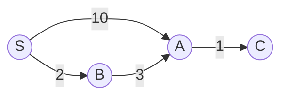
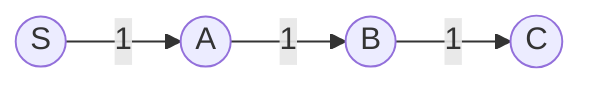
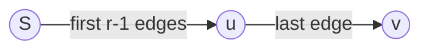

# [743] Network Delay Time
**Pattern:** [Heap / Priority Queue](../../patterns/heap.md)
**Complexity:** Time O(V + E log(E + 1)), Space O(V + E)
**Link:** https://leetcode.com/problems/network-delay-time/

## Trigger Signals

- 給定單一起點 `k`，求訊號傳播到所有節點的最短時間。先將問題建模為 Single-Source Shortest Path（SSSP）。
- 有向邊上的時間皆非負；每個節點最早收到訊號的時間，就是從 `k` 到該節點的最短距離。
- 所有電腦都收到訊號的時間，是所有節點最短距離的最大值。若存在無法抵達的節點，回傳 `-1`。

## Core Insight

原本曾把 Priority Queue 的排序依據想成單條 Edge Weight；後來釐清 Dijkstra 要比較的是 **從 Source 到節點的累積距離**，而不是連接該節點的最後一條邊。前者求 SSSP，後者比較像 Prim's MST 的選邊準則。

最終版本使用 Adjacency List、`dist[v]` 與 Min-Heap `(cost, node)`。只有找到更低成本時才 Relax，更新 `dist[v]` 並 Push；Pop 到成本比 `dist[v]` 大的 Entry 就跳過。全部可達節點的距離算完後，取 `dist[1..n]` 的最大值。



圖中第一次發現 `A` 的成本是 10，後來透過 `B` 找到成本 5。`dist[A]` 應更新為 5，並再次 Push `(5, A)`；舊的 `(10, A)` 留在 Heap 中，等它被 Pop 時再跳過。

## Why It's Correct

### Tentative Distance 與 Finalized Distance

`dist[v]` 記錄目前已知從 Source 到 `v` 的最低成本（Tentative Distance），**不代表一定已證明是全域最短**。Relaxation：

\[
dist[v] \leftarrow \min(dist[v],\ dist[u]+w(u,v))
\]

一旦發現更好的候選路徑，就可以更新 Tentative Distance；當最新的 `(dist[u], u)` 從 Min-Heap 被 Pop 出來時，才可把 `u` 的最短距離視為 Finalized。這兩個時間點並不矛盾。

### 為什麼 Dijkstra Pop 出的距離一定最短

反證：假設某個節點 `u` 以成本 `d` 被 Pop，但存在另一條成本小於 `d` 的路徑。考慮該路徑上第一個尚未 Finalized 的節點 `x`，其前一個節點已處理過，所以應該已對 `x` Relax。由於所有邊權非負，`x` 的候選成本不大於整條路徑成本，因而小於 `d`。Min-Heap 應先 Pop `x`，不可能先 Pop `u`，矛盾。

**English interview answer**

> Suppose a node u is popped with distance d, but a shorter path exists. Consider the first unsettled node x on that path. Its predecessor has already been settled, so relaxation must have produced a tentative distance for x smaller than d. Since all edge weights are non-negative, the min-heap would pop x before u. This is a contradiction. Therefore, u's distance is final when it is popped.

### 為什麼可以跳過 Stale Entry

如果 PQ 同時有 `(3, A)` 和 `(10, A)`，且 `dist[A] = 3`，則 `(10, A)` 是 Stale Entry。因為對每條從 A 出發的邊，`3 + w < 10 + w`，使用成本 10 延伸的路徑不可能優於從成本 3 延伸的同一條路徑。這是 Dominance，不會漏掉更好的解。

**English interview answer**

> The entry is stale because a better tentative distance to the same node has already been found. Extending a higher-cost path along any outgoing edge cannot improve upon extending the lower-cost path. Therefore, skipping the stale entry is safe.

### 為什麼答案是最大距離

每台電腦在從 `k` 出發的最短傳播時間 `dist[v]` 收到訊號。所有電腦都收到訊號，必須等最晚收到的那台，因此答案為 `max(dist[1..n])`。若某個距離仍為 `INT_MAX`，表示不可達，答案是 `-1`。

## Complexity Analysis

令 V 為節點數，E 為有向邊數。

- **Build Graph：O(V + E)**。配置 V + 1 個 Adjacency Lists，並加入 E 條有向邊。
- **Heap / Relaxation：O(E log(E + 1))**。每個節點在以最新成本被 Pop 後才展開其 Outgoing Edges；每條邊最多觸發一次成功 Relaxation，因此最多 E 次 Relaxation Push，另加起點一次。Heap 最多有 E + 1 筆 Entry，一次 Push / Pop 為 O(log(E + 1))。
- **初始化、結果掃描：O(V)**。
- **Time：O(V + E log(E + 1))**。比單寫 `O(E log E)` 更完整，因為還有 V 個節點的工作。
- **Space：O(V + E)**。Graph 為 O(V + E)，`dist` 為 O(V)，Lazy Heap 最多 O(E)。

在 Simple Graph 的條件下，也常看到 `O((V + E) log V)` 的上界寫法。這裡保留原先推導過的 Heap Size 觀點：Heap 並不一定只有 V 個元素，而是最多 O(E) 筆 Entry。

## Solution Code

### 寫法 1 — 本次 AC 版本（原始碼保留）

```cpp
class Solution {
public:
    int networkDelayTime(vector<vector<int>>& times, int n, int k) {

        // build graph
        vector<vector<pair<int, int>>> g(n+1);
        for (int i = 0; i < times.size(); i++) {
            int u = times[i][0];
            int v = times[i][1];
            int w = times[i][2];
            // directed graph
            g[u].push_back({v, w});
        }

        vector<int> dist(n + 1, INT_MAX);
        // <cost, dst>
        priority_queue<pair<int, int>, vector<pair<int, int>>,
                       greater<pair<int, int>>>
            pq;
        // start from k
        dist[k] = 0;
        pq.push({0, k});
        while (!pq.empty()) {
            auto [cost, dst] = pq.top();
            pq.pop();
            // stale data
            if (cost > dist[dst]) {
                continue;
            }
            for (auto [node, weight]: g[dst]) {
                // relax
                if (cost + weight < dist[node]) {
                    pq.push({cost + weight, node});
                    dist[node] = cost + weight;
                }
            }
        }
        int res = *max_element(dist.begin()+1, dist.end());
        return res == INT_MAX ? -1 : res;
    }
};
```

### 補充寫法 2 — Bellman-Ford（非本人原始碼）

這是另一個值得掌握的 SSSP 解法。它不依賴 Min-Heap；即使邊權為負，也能求得最短路徑，前提是沒有從起點可達、會讓最短路徑無界下降的 Negative Cycle。此題本來就只有非負權重，Dijkstra 較有效率。

```cpp
class Solution {
public:
    int networkDelayTime(vector<vector<int>>& times, int n, int k) {
        const int INF = INT_MAX;
        vector<int> dist(n + 1, INF);
        dist[k] = 0;

        for (int round = 1; round < n; ++round) {
            bool changed = false;
            for (const auto& edge : times) {
                int u = edge[0];
                int v = edge[1];
                int w = edge[2];
                if (dist[u] == INF) continue;
                if (dist[u] + w < dist[v]) {
                    dist[v] = dist[u] + w;
                    changed = true;
                }
            }
            if (!changed) break;
        }

        int answer = 0;
        for (int v = 1; v <= n; ++v) {
            if (dist[v] == INF) return -1;
            answer = max(answer, dist[v]);
        }
        return answer;
    }
};
```

## Alternatives / Optimization

### Bellman-Ford：為什麼 V−1 輪就夠？（圖解）

**注意：不是總共 Relax V−1 次，而是做 V−1 輪，每一輪都掃過所有 E 條邊。**



假設每一輪檢查邊的順序剛好最不利：`B → C`、`A → B`、`S → A`。這樣即使每輪所有邊都會被檢查，更新也不會立刻傳到終點。

| 階段 | dist[S] | dist[A] | dist[B] | dist[C] |
|---|---:|---:|---:|---:|
| 初始化 | 0 | INF | INF | INF |
| Round 1 | 0 | 1 | INF | INF |
| Round 2 | 0 | 1 | 2 | INF |
| Round 3 | 0 | 1 | 2 | 3 |

這說明的不是「一輪只能前進一條邊」，而是 **「不管掃描順序如何，一輪至少能多保證一條邊的路徑已被考慮」**。若依 `S → A`、`A → B`、`B → C` 掃描，原地更新甚至第一輪就能傳到 C。

### Bellman-Ford：Mathematical Induction（數學歸納法）

**Base Case：** Round 0 時，`dist[S] = 0`，因此不使用任何 Edge 的起點距離正確。

**Inductive Hypothesis：** 假設 Round `r-1` 結束後，所有使用至多 `r-1` 條 Edge 的路徑成本，都已被考慮，`dist` 不大於這些路徑的成本。

**Inductive Step：** 對任意使用 `r` 條 Edge 的路徑，將它拆成前 `r-1` 條 Edge（從 S 到 u）以及最後 `u → v` 一條 Edge：



根據假設，上一輪已經有 `dist[u]` 不大於前半段的路徑成本；這輪一定會掃到 `u → v`，因此 Relax `dist[v] = min(dist[v], dist[u] + w)` 就會考慮完整的 `r` 條邊路徑。故命題對 Round r 仍成立。

因為沒有可達 Negative Cycle 時，最短路徑可取 Simple Path，而 V 個節點的 Simple Path 最多 V−1 條 Edge，所以 **V−1 輪足夠**。原地更新可能提早考慮超過 r 條 Edge 的路徑，不影響這個下界保證。

**English interview answer**

> Bellman-Ford performs V minus one rounds, and each round relaxes every edge. By induction, after round r, all paths using at most r edges have been accounted for. For a path of r edges, its first r minus one edges are covered by the previous round; relaxing its last edge extends the guarantee to the full path. Since a shortest simple path uses at most V minus one edges when there is no reachable negative-weight cycle, V minus one rounds are sufficient.

**Complexity：** Time O(VE)，Space O(V)（不含輸入邊列表）。如允許負權重，為避免 `int` Overflow，可使用 `long long` 或在加法前檢查範圍；本題給定的非負權重上限使上述程式可使用 `int`。

## Pitfalls

- **把 Edge Weight 當作 Dijkstra 的 PQ Key**：這會混淆成 Prim's MST；正確排序依據是 Source 到候選節點的累積成本。
- **無條件 Push 鄰居**：在 `1 → 2 → 1` 等 Cycle 中可能無限往 Queue 加入新 Entry；必須檢查 `newCost < dist[v]` 才 Relax。
- **只 Push，卻沒有在 Relaxation 時更新 `dist[v]`**：即使可得到 AC，也可能把相同節點以同樣成本重複展開，無法維持標準 Dijkstra 的 E 次成功 Relaxation 分析。
- **把 Pop 時確認距離誤解成只能在 Pop 時寫 dist**：`dist` 先存 Tentative Distance；Pop 最新 Entry 才能確定 Finalized Distance。
- **只用 `cost > dist[u]` 跳過 Stale Entry，卻忘記同步更新 dist**：舊資料無法被正確辨識，導致重複工作。
- **把終止條件寫成「所有 Edge 都看完」**：真正的條件是 PQ 已空；不可達節點的 Edge 從未被展開，最後使用 `INT_MAX` 判定並回傳 `-1`。
- **複雜度忘記 V**：除 O(E log E) 的主要 Heap 成本，初始化與答案掃描還有 O(V)。
- **Bellman-Ford 的輪數與操作數混淆**：V−1 指輪數，每輪掃描 E 條 Edge；原地更新可能一輪傳遞多條 Edge 的資訊。

## Side Notes

### Dijkstra 與 Prim 的差異

| | Dijkstra | Prim's MST |
|---|---|---|
| PQ 排序 Key | 從 Source 的累積最短成本 | 接到目前生成樹的單一 Edge 成本 |
| 目的 | 計算最短路徑 | 找總成本最低的生成樹 |
| 適用情境 | 非負權重的 SSSP | 無向加權圖的 MST |

### SSSP、APSP、負權重

- SSSP 與 APSP 是問題類型，不是演算法名稱。APSP 求出的距離自然包含單一起點需要的結果，但通常做了過多工作。
- Dijkstra 適用非負權重。Bellman-Ford 可以處理負權重，也能檢查是否有可達的 Negative Cycle。
- Floyd-Warshall 求 APSP，可處理負權重，但若存在相關 Negative Cycle，最短距離就不再有有限解。

## Related Problems

- [[1293] Shortest Path in a Grid with Obstacles Elimination](../bfs/shortest_path_in_a_grid_with_obstacles_elimination.md) — 等權 BFS 的距離保證，對比 Dijkstra 的非負加權距離。
- [934] Shortest Bridge — 先辨識一座島，再進行 Multi-source BFS；加權版可以延伸成 Multi-source Dijkstra。
- [787] Cheapest Flights Within K Stops — 最短成本加上轉機次數限制；需要額外 State 或限制 Relaxation 輪數。
- [2290] Minimum Obstacle Removal to Reach Corner — 權重只有 0 或 1，可以比較 0-1 BFS 與 Dijkstra。
- [1631] Path With Minimum Effort — Dijkstra 變形；路徑成本是最大單步落差，而非各邊成本相加。
